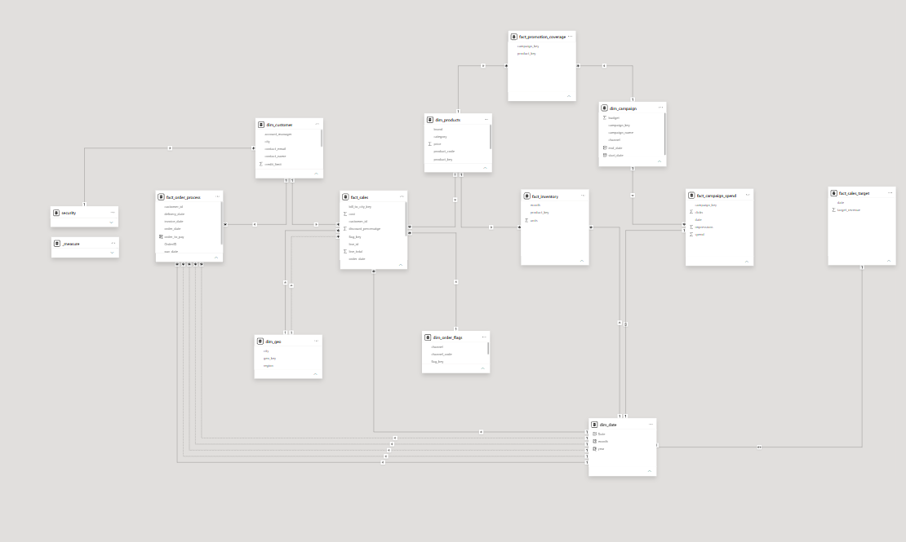

<div align="center">


<br/>


</div>

---

## 🚀 About the Project

Raw business data rarely arrives ready to analyze. This project takes a **messy, multi-sheet sales dataset** and turns it into a **clean, well-structured data model** that is fast, easy to understand and ready for reporting.

> **Goal:** one trustworthy model where sales, orders, inventory, campaigns and targets can all be analysed together.

| 📥 Raw Input | 📤 Final Output |
|:---:|:---:|
| **23 sheets** (orders split by year, wide inventory, comma-separated SKUs, duplicate tabs) | **14 tables**: 7 dimensions, 6 facts and 1 security table |

---

## 🗺️ Data Model

<div align="center">



</div>

### 🧱 Tables in the Model

<table>
<tr>
<td valign="top" width="50%">

**🔷 Dimension tables**
- `dim_customer`
- `dim_products`
- `dim_geo`
- `dim_campaign`
- `dim_order_flags`
- `dim_date`

</td>
<td valign="top" width="50%">

**🟢 Fact tables**
- `fact_sales`
- `fact_order_process`
- `fact_inventory`
- `fact_campaign_spend`
- `fact_promotion_coverage`
- `fact_sales_target`

**⚙️ Support tables:** `_measure` (all DAX metrics) and `security` (region-based access)

</td>
</tr>
</table>

---

## ⭐ Star Schema + 🌌 Galaxy Schema

**⭐ Star schema:** `fact_sales` sits in the centre. It connects to `dim_customer`, `dim_products`, `dim_geo`, `dim_order_flags` and `dim_date`, so sales can be sliced by who, what, where, how and when.

**🌌 Galaxy schema (fact constellation):** several fact tables share the same dimensions. For example, `dim_date` is used by sales, orders, inventory, campaign spend and targets, and `dim_products` is shared by sales, inventory and promotions. Because of this, different business areas can be compared side by side.


---

## 🧹 Data Cleaning & Preprocessing

<table>
<tr>
<th>🔴 Problem in raw data</th>
<th>🟢 What I did</th>
</tr>
<tr>
<td>Orders split into <code>ORDERS_2025</code> and <code>ORDERS_2026</code> with different columns</td>
<td>Appended into one order table and removed the extra, unused columns</td>
</tr>
<tr>
<td>Customer info spread across 4 sheets (master, address, contacts, credit details)</td>
<td>Merged into a single <code>dim_customer</code></td>
</tr>
<tr>
<td>Product category stored as <code>electronics|phones</code> in one text cell</td>
<td>Split into proper category and subcategory columns in <code>dim_products</code></td>
</tr>
<tr>
<td>Inventory stored <b>wide</b> (one column per month)</td>
<td><b>Unpivoted</b> into rows to build <code>fact_inventory</code> (product, month, units)</td>
</tr>
<tr>
<td>Promoted SKUs stored as comma-separated text per campaign</td>
<td>Split into one row per campaign and product, giving <code>fact_promotion_coverage</code></td>
</tr>
<tr>
<td>Campaign details repeated on every daily log row</td>
<td>Separated into <code>dim_campaign</code> (descriptions) and <code>fact_campaign_spend</code> (daily numbers)</td>
</tr>
<tr>
<td>Cities and regions in separate sheets</td>
<td>Combined into <code>dim_geo</code> with a surrogate key</td>
</tr>
<tr>
<td>Duplicate sheet (<code>Sheet1</code> is identical to <code>shipments</code>) and technical columns (<code>hash_key</code>, <code>source_id</code>)</td>
<td>Removed the duplicates and unneeded columns</td>
</tr>
<tr>
<td>Free-text notes and empty gift messages</td>
<td>Dropped from the model to keep it lean</td>
</tr>
<tr>
<td>Missing values (delivery dates, brand, supplier)</td>
<td>Handled so they do not break the metrics</td>
</tr>
<tr>
<td>Shipments, invoices and payments in separate tables</td>
<td>Combined into <code>fact_order_process</code> to follow an order from order date to invoice to delivery</td>
</tr>
<tr>
<td>Text IDs and names used for joins</td>
<td>Replaced with <b>surrogate keys</b> (<code>product_key</code>, <code>geo_key</code>, <code>flag_key</code>, <code>campaign_key</code>)</td>
</tr>
</table>


## 🔐 Row-Level Security

The `security` table maps each user's email to a **region**, so a regional manager only sees data for their own region.

---

## 🛠️ Tools Used

<div align="center">


</div>

---

## 📁 Project Structure

```
📦 Sales-Data-Modeling
 ┣ 📂 assets
 ┃ ┣ 🖼️ data_model.png
 ┃ ┗ 🖼️ tables.png
 ┣ 📊 Sales_Data_Model.pbix
 ┣ 📄 dataset.xlsx
 ┗ 📝 README.md
```

---

## 🎯 What I Learned

- 🧠 Designing a **star schema** and extending it into a **galaxy schema**
- 🔗 Handling **many-to-many** relationships with a bridge table
- 🧹 Cleaning real-world, messy data with **Power Query**
- 📏 Writing reusable **DAX measures** in a dedicated measure table

---

<div align="center">

⭐ **If you liked this project, give it a star!** ⭐


</div>
